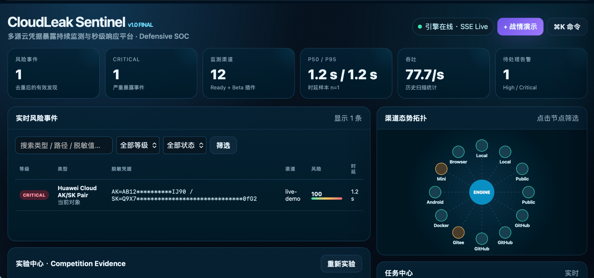
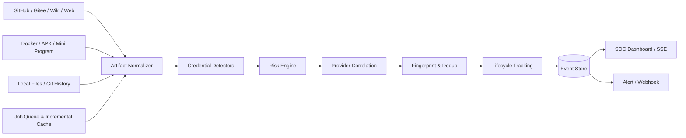

# CloudLeak Sentinel

[](https://github.com/TerenceWangShenxing/cloudleak-sentinel/actions/workflows/tests.yml)


**多源云凭据暴露持续监测与秒级响应平台 · Defensive SOC Prototype**

CloudLeak Sentinel 面向代码托管、Git 历史、Wiki/公开网页、Docker/OCI、Android APK、小程序及浏览器上传等渠道，统一发现并关联分析 AK/SK、API Token、SSH/PEM 私钥、数据库凭据、OAuth Client Secret、JWT 等敏感凭据暴露。

> **安全边界**：仅分析明确指定或授权的目标；不登录、不验证、不使用发现的真实凭据。持久化默认只保存脱敏值与 SHA-256 指纹。Demo/Benchmark 全部使用合成数据。



## Why CloudLeak Sentinel

- **12 类渠道/解析能力**：Local Files、Local Git Lifecycle、GitHub Repo、GitHub Push Webhook、GitHub Continuous Monitor、Gitee、Public URL、Wiki/Knowledge Page、Docker/OCI TAR、Android APK、Mini Program、Browser Upload。
- **15 类规则/组合检测器**：包含 Huawei/AWS/Alibaba/Tencent 云凭据关联检测、OAuth、GitHub Token、SSH/PEM、数据库 URI、JWT、Generic Secret 等。
- **Credential Risk Engine**：Regex + Entropy + Context + Sensitive Path + Placeholder Suppression + Provider Correlation + Risk Score。
- **暴露生命周期**：跟踪凭据首次出现、后续删除、历史残留与当前状态，而不是把删除 patch 当成新的泄露。
- **实时与增量**：任务队列、内容指纹增量缓存、GitHub Webhook/SSE、P50/P95 发现时延。
- **治理闭环**：Dedup、Allowlist、Alert、事件检索、详情抽屉、任务中心、渠道健康度。
- **Competition Evidence**：Regression、Curated Adversarial、Scale、Incremental、Pipeline Latency 等实验框架，区分合成评测与真实端到端实验。

## Architecture



## Quick Start

Python 3.10+（推荐 3.12）。

```bash
python3 -m venv .venv
source .venv/bin/activate
pip install -r requirements.txt
uvicorn sentinel.api:app --host 127.0.0.1 --port 8000 --reload
```

浏览器打开：`http://127.0.0.1:8000/`

健康检查：

```bash
curl http://127.0.0.1:8000/health
```

## Competition Demo

运行完全合成的本地演示（测试数据在运行时生成，不把凭据样例直接提交到主仓库）：

```bash
bash scripts/demo_all.sh
```

运行实验：

```bash
python3 scripts/run_final_experiments.py
pytest -q
```

Dashboard 支持：

- `⌘/Ctrl + K`：命令面板
- `/`：事件搜索
- `D`：战情演示实验室
- `R`：刷新
- `Esc`：关闭面板/抽屉

## GitHub / Gitee configuration

凭据只通过环境变量提供，不写入源码：

```bash
cp .env.example .env
export GITHUB_TOKEN='...'
export GITEE_TOKEN='...'
```

推荐只授予被监控测试仓库的最小只读权限。

## Evaluation

仓库包含两类内部测试：

1. `benchmark/cases.json`：Synthetic regression，用于版本回归。
2. `benchmark/evaluation_cases.json`：Curated adversarial set，用于测试 near-miss / placeholder / provider-pair 等边界情况。

这些数据**不代表真实互联网准确率**。正式比赛指标应在独立样本和真实授权 Webhook 实验上重新测量，并记录硬件、Python 版本、网络环境、样本量以及 P50/P95。

## Project layout

```text
sentinel/                 core engine + API + dashboard
sentinel/sources/         source adapters
benchmark/                synthetic / curated evaluation cases
scripts/                  demo and experiment scripts
tests/                    automated tests
docs/                     design and competition documentation
reports/                  generated experiment outputs (not committed by default)
```

## Documentation

- `docs/TECHNICAL_DESIGN.md`
- `docs/CHANNELS.md`
- `docs/CREDENTIAL_TYPES.md`
- `docs/FINAL_COMPETITION_GUIDE.md`
- `SECURITY.md`

## Responsible Use

The project is designed for defensive monitoring. Do not use it to search for, validate, exploit, or access third-party credentials or systems without authorization.
